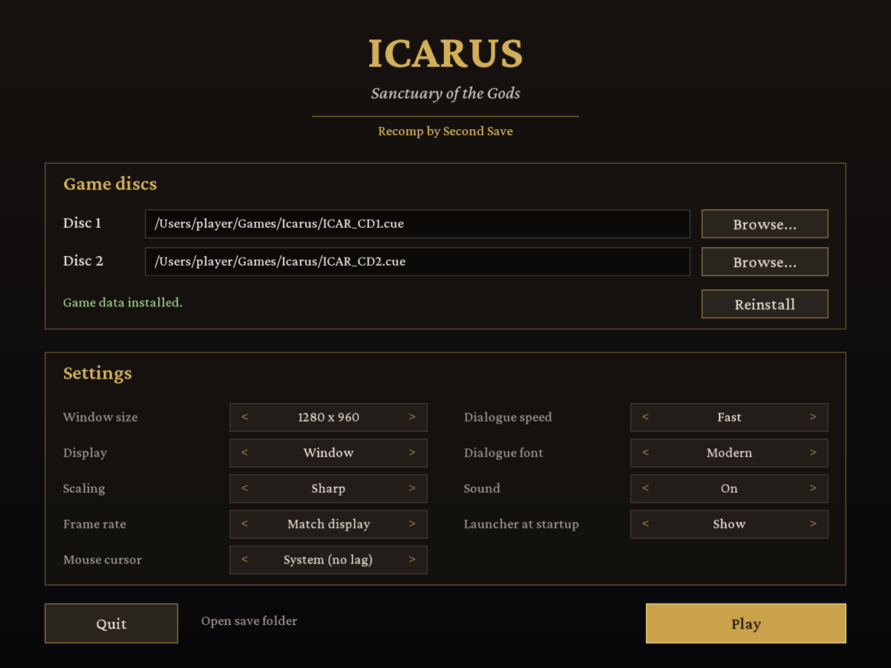

# Icarus: Sanctuary of the Gods (Droiyan), static recompilation

**Recomp by Second Save**



A native port of the 1998 Windows 95 RPG *Icarus: Sanctuary of the Gods* (Korean title *Droiyan*,
KRG Soft / JC Research) for macOS, Linux and Windows. The game's x86 code (`ICARUS.EXE`, MSVC 5) is
translated to C ahead of time, and a small runtime replaces the Win32 / DirectX 5 APIs it used with
SDL3.

Nothing is emulated at run time: no Windows, no Wine, no CPU interpreter.

## How it works

| Piece | What it does |
|---|---|
| `tools/recomp.py` | Disassembles `ICARUS.EXE` (Capstone), finds every function (call targets, relocation table, incremental-link thunks, switch tables) and writes one C function per guest function into `gen/`. |
| `runtime/rt.h`, `rt_core.c` | CPU state, lazy flags, x87, string ops, dispatcher for indirect calls, host-to-guest callbacks. |
| `runtime/w32_kernel.c` | Imports and COM vtables point at "magic" addresses served by host functions. Also the guest heap, files (case-insensitive, copy-on-write saves) and process queries. |
| `runtime/w32_user.c` | Window, message queue, keyboard/mouse (SDL3), GDI text, `wsprintf`. |
| `runtime/w32_ddraw.c` | DirectDraw surfaces in guest memory (8- and 16-bit modes), Blt/BltFast/Flip, palettes, presentation. |
| `runtime/w32_dsound.c` | DirectSound buffers mixed in software, plus the CD audio music tracks. |
| `runtime/w32_mm.c` | Multimedia timers (delivered on the game thread), MCI `cdaudio`, the `mmio` RIFF reader. |
| `runtime/w32_avi.c` | AVIFile stream reading and a Cinepak decoder for the game's own movie player. |
| `runtime/launcher.c`, `runtime/installer.c` | Launcher window and the disc installer (ISO9660, InstallShield 3 via `runtime/is3.h`, CD audio, EXE check, memory image). |
| `runtime/qol.c` | Hardware cursor from the game's sprites, dialogue speed. |
| `runtime/text.c` | Replacement text renderer: anti-aliased, proportional Crimson Pro glyphs blended through the game palette (`ICARUS_FONT=original` for the 1998 font). |
| `tools/prepare_data.py`, `tools/is3unpack.c` | Rebuild the installed game from the original discs: ISO9660 extraction, the InstallShield 3 `.Z` archives (PKWARE DCL), and the CD audio tracks. |

## You need

* The two original discs as BIN/CUE images (`ICAR_CD1.cue/.bin`, `ICAR_CD2.cue/.bin`).
* A C compiler (clang or gcc; MinGW-w64 on Windows) and SDL3 (`brew install sdl3`, `apt install libsdl3-dev`, MSYS2 `mingw-w64-x86_64-SDL3`).
* Python 3 with `capstone` and `pefile` to regenerate `gen/` (`pip install capstone pefile`).

## Launcher

Running `icarus` opens the launcher:

* **Game discs:** pick disc 1 and disc 2 (`.cue` + `.bin`, a bare `.bin`, or `.iso`), then
  **Install**. The game files are unpacked from the original installer archives, `ICARUS.EXE` is
  checked against the release this build was made from, and the CD music is saved. This takes a
  few seconds; disc 2 must be a `.cue` for the music. Disc images are only read.
* **Settings:** window size, fullscreen, scaling, frame rate, mouse cursor, dialogue speed and
  font, sound, and whether to show the launcher at startup. Left-click a setting for the next value,
  right-click for the previous one.
* **Play** (or Enter) starts the game; Esc quits. `icarus --play` skips the launcher.

Data, saves and settings are stored per user: `~/Library/Application Support/Second Save/Icarus`
(macOS), `%APPDATA%\Second Save\Icarus` (Windows), `~/.local/share/Second Save/Icarus` (Linux).
When the working folder has a `data/` folder (developer layout, see below), `data/`, `save/` and
`icarus.cfg` there are used instead.

## Build

```sh
make build/is3unpack
make data CD1=path/to/ICAR_CD1.cue CD2=path/to/ICAR_CD2.cue   # builds data/ (about 870 MB, 530 MB of it CD music)
make gen PY=python3                                            # translate data/ICARUS.EXE -> gen/
make -j8                                                       # -> ./icarus
./icarus
```

`data/` holds the installed game files, `droiyan.ini` (the CD drive the game reads from: `D:\`),
and `data/cd/` (the run-time CD contents: maps, movies, music as WAV). Saved games and options go to
`save/`. The original files in `data/` are never modified.

## Controls

The game's own controls: mouse for everything, Space or click to skip the intro movie, Esc to skip
the prologue. Added by this port:

| Key | Action |
|---|---|
| Hold **Tab** | Fast-forward (4x) |
| **F11** or **Alt+Enter** | Toggle fullscreen |
| **F12** | Screenshot to `screenshots/` |
| Click or any key during the boot logos | Skip straight to the title screen |

## Quality of life

* **Lag-free mouse:** the game's own cursor sprite is shown as the system cursor at the window's
  scale, so it moves at full display rate instead of one frame behind (`HWCURSOR = 0` to disable).
* **Display-synced frame rate:** like on 1998 hardware, where Flip waited for the monitor, the
  game runs in step with the display: 60/75/85 Hz every refresh, 120/144 Hz every second one. No
  judder from a 60 fps game on a 75 Hz screen. `FPS = 60` forces a rate.
* **Sharp scaling:** crisp pixels of even size at any window size or in fullscreen (integer
  upscale, then a smooth resize). `SCALE_MODE = nearest | smooth | integer`.
* **Faster dialogue:** text types twice as fast (`TEXT_SPEED = 1` original, `0` instant).
* **Readable font:** anti-aliased Crimson Pro instead of the 1998 bitmap font (`FONT = original`).
* **Lower sound latency**, music that loops, and sound effects that load reliably.

Settings live in `icarus.cfg` (created on first run, next to where you start the game). Every
`KEY = value` there is the same as setting the environment variable `ICARUS_KEY`.

## Environment variables

| Variable | Effect |
|---|---|
| `ICARUS_DATA=dir` | Game data folder (default `./data`, or `data/` next to the binary). |
| `ICARUS_SAVE=dir` | Save folder (default `./save`). |
| `ICARUS_SCALE=n` | Initial window scale (default 2). `ICARUS_FULLSCREEN=1` starts fullscreen. |
| `ICARUS_SMOOTH=1` | Bilinear scaling instead of sharp pixels. |
| `ICARUS_MUTE=1` | No sound. |
| `ICARUS_WARP=1` | Let the game move the host mouse pointer (`SetCursorPos`). |
| `ICARUS_VERBOSE=1` | Log files, surfaces, sound buffers and MCI calls. |
| `ICARUS_TRACE=1` | Log every Win32/COM call (`ICARUS_TRACE_QUIET=Name1,Name2` hides noisy ones). |
| `ICARUS_HEADLESS=1` | No window (testing). With `ICARUS_SHOT=file%04d.ppm` and `ICARUS_SHOT_EVERY=n` it saves frames. |
| `ICARUS_FONT=original` | Use the game's original 8x16 bitmap font instead of the anti-aliased replacement. |
| `ICARUS_AUDIO_DUMP=file.raw` | Also write the mixed audio (s16 stereo 44.1 kHz) to a file. |
| `ICARUS_FPS=n` | Fixed frame rate instead of following the display refresh. |
| `ICARUS_SCALE_MODE=m` | `sharp` (default), `nearest`, `smooth` or `integer`. |
| `ICARUS_TEXT_SPEED=n` | Dialogue speed: 1 original, 2 default, 0 instant. |
| `ICARUS_HWCURSOR=0` | Draw the cursor in the game frame instead of as the system cursor. |
| `ICARUS_VSYNC=0` | No vsync; host pacing at 60 fps. |
| `ICARUS_RECORD=f.rgb` | Record raw 640x480 RGB frames at a constant `ICARUS_RECORD_FPS` (default 30), for trailers (`tools/make_trailer.py`). |
| `ICARUS_STATS=1` | Print presents/flips per second and the worst frame gap. |
| `ICARUS_CONFIG=file` | Settings file (default: per-user folder, or `icarus.cfg` in the developer layout). |
| `ICARUS_LAUNCHER=0` | Do not show the launcher (same as `LAUNCHER = 0` in the settings). |
| `ICARUS_LAUNCHER_SHOT=f.bmp`, `ICARUS_LAUNCHER_AUTO=play\|install\|quit` | Testing: capture the launcher, then act. |
| `ICARUS_KEYS=t:vk,...`, `ICARUS_CLICKS=t:x:y[:right],...` | Scripted input at t seconds (testing). |

| `ICARUS_SNDTEST=slot:entry,...` | Testing: 20 s in, load and play DROYSND.SNF entries through the game's own loader. |
| `ICARUS_CDDA_MAXSEC=n` | Testing: cut every CD track to n seconds (checks music looping). |

`tools/run_headless.sh SECONDS` and `tools/shots.sh T...` wrap the testing knobs. Test runs use
`build/testsave`, never `save/`.

## Credits

The replacement dialogue font is [Crimson Pro](https://github.com/Fonthausen/CrimsonPro) by the
Crimson Pro Project Authors, under the SIL Open Font License 1.1 (`tools/fonts/CrimsonPro-OFL.txt`).
`runtime/font_text.h` is generated from it by `tools/mkfont_ttf.py`.

## Sharing it

The recompiler, runtime and tools are original code. `gen/` (the translated game code) and `data/`
are derived from the copyrighted game, so share the source tree and let players run
`make data` / `make gen` against their own discs, rather than publishing `gen/`, `data/` or a
prebuilt binary that bundles them.

## Status

Working: boot logos, title menu, intro movie (Cinepak + audio), prologue, CD music, sound effects,
the opening scene and dialogue. See `NOTES.md` for what has and has not been tested yet.

## Continuous integration

`.github/workflows/build.yml` builds the runtime and tools on Linux (Debian trixie), macOS
(Homebrew) and Windows (MSYS2 UCRT64, clang) against `ci/stub-gen`, a stand-in for `gen/` with no
game code, and runs `ci/smoke.sh`. The playable game is only ever built locally from your own discs.
